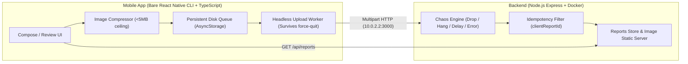

# Technical Assessment: Field Reports (React Native & Node.js Backend)

A complete, production-grade offline-first field reporting system designed for inspectors working in remote sites over intermittent 2G and absent network connections.

---

## 🏗️ Architecture & Philosophy



### Core Guarantees Implemented

1. **"Nothing is lost" (Survives Force-Quit & Reboot):**
   - The moment a report is submitted in the app, it is immediately persisted to the device's disk storage in a `QUEUED` state *before* any network call is initiated.
   - Force-quitting the app mid-upload or rebooting the phone will not lose the work. On restart, the headless worker automatically picks up unfinished reports and resumes delivery unattended.
2. **"Nothing lands twice" (Strict Idempotency):**
   - Every report generates a persistent `clientReportId` (UUID) upon creation.
   - If an upload request succeeds on the backend but the response is dropped over a flaky 2G connection, the app will retry with the exact same `clientReportId`.
   - The backend checks for duplicate IDs: if it already exists, it rejects duplicate insertion, cleans up duplicate incoming files, and returns `200 OK` with the existing report.
3. **5 MB Image Ceiling & Large Camera Photos:**
   - Real-world 18MB camera photos are seamlessly handled by our `compressor.ts` pipeline, resizing dimensions (max 2048px) and optimizing JPEG quality to ~1.5–2.5 MB (well under the 5 MB destination ceiling) while retaining full inspector clarity.
4. **"The upload logic must be exercisable without rendering a screen":**
   - The entire `UploadQueueManager` and network retry state machine are completely decoupled from React Native UI components.
   - A dedicated headless automated verification suite tests queueing, offline buffering, force-quit recovery, and network reconnection without mounting any React components.
5. **UI & UX Judgement ("It never lies", "One glance, one answer"):**
   - Explicit status badges: `Saved locally • Queued`, `Optimizing Photos`, `Uploading (45%)`, `Interrupted • Retrying`, `Confirmed on Server`.
   - The Review screen fetches directly from the server (`GET /api/reports`), never reading back local optimistic state.
   - A deliberate "Start Over" reset button wipes both backend data and local queue with explicit user confirmation.

---

## 🚀 How to Run the Project

### 1. Stand Up the Backend

#### Option A: Docker Compose (Recommended)
From the project root:
```bash
docker compose up --build
```
The server will be live on `http://localhost:3000` (and `http://10.0.2.2:3000` for Android emulator).

#### Option B: Direct Node.js
```bash
cd backend
npm install
npm run dev
```

### 2. Run the React Native Mobile App

Make sure an Android Emulator is running or a device is connected:
```bash
cd mobile
npm install
npx react-native run-android
```
*(Note: Android manifest is configured with `android:usesCleartextTraffic="true"` to communicate seamlessly with the local backend running on `http://10.0.2.2:3000`).*

---

## 🧪 Automated Verification Suites

Both backend and mobile logic can be verified completely headlessly:

### 1. Backend Verification (9 Tests)
Tests root health, reset, 5MB ceiling enforcement, non-blank description, idempotency, and on-demand failure modes:
```bash
cd backend
npm test
```
```text
✅ PASS: Health check 200 OK
✅ PASS: Reset executed cleanly (POST /api/reset)
✅ PASS: Report created with image
✅ PASS: Idempotency verified! Duplicate rejected, count remains 1
✅ PASS: Blank description correctly rejected with 400 Bad Request
✅ PASS: File >5MB rejected with 413 Payload Too Large
✅ PASS: On-demand forced 503 error returned (x-chaos-error)
✅ PASS: On-demand delay verified (1500ms elapsed)
✅ PASS: Connection drop verified! Socket destroyed abruptly (x-chaos-drop)
```

### 2. Mobile Queue Headless Verification (5 Tests)
Exercised without rendering a screen:
```bash
cd mobile
npm run test:headless
```
```text
✅ PASS: Blank description correctly rejected
✅ PASS: 0 images correctly rejected
✅ PASS: Report safely stored on disk in QUEUED state without network activity
✅ PASS: "Nothing is lost" — Report survived simulated force-quit!
✅ PASS: Unattended upload completed upon reconnection! Status: SUCCESS
```

---

## 💥 How to Make it Fail on Demand (Chaos Simulation)

The backend has built-in chaos engineering features. You can test failure modes either via request headers or through the chaos API:

### 1. Via Request Headers (Per-request trigger)
- **Drop Connection Mid-Upload:** Send `x-chaos-drop: true` (server calls `req.socket.destroy()` immediately).
- **Hanging Connection (Timeout):** Send `x-chaos-hang: true` (server holds request without answering).
- **Simulate 2G Latency:** Send `x-chaos-delay: 5000` (injects 5-second artificial delay).
- **Forced Error:** Send `x-chaos-error: 500` or `503`.

### 2. Via Global Chaos API
Enable random drops and delay globally:
```bash
POST http://localhost:3000/api/chaos
Content-Type: application/json

{
  "enabled": true,
  "delayMs": 4000,
  "dropRate": 0.3,
  "failureRate": 0.2
}
```

---

## 📋 Architectural Decisions & Trade-Offs

| Decision | Rationale | Trade-Off |
| :--- | :--- | :--- |
| **Custom Express Backend vs Firebase/Supabase** | Firebase/Supabase make simulating dropped TCP sockets and hanging requests awkward. Express gives 100% control over chaos testing and idempotency. | Requires running a Node process or Docker container locally. |
| **Persistent Queue on Disk** | Guarantees that reports survive force-quits and battery death on remote sites. | Writes to disk before attempting network upload (negligible ~5ms overhead). |
| **Client-Side Image Compression** | Respects the hard 5 MB ceiling at destination and saves 2G cellular bandwidth by compressing 18MB camera photos to ~2MB. | Uses mobile CPU cycles to re-encode JPEG before upload. |
| **Decoupled Headless Queue Manager** | Meets the core requirement: *"Upload logic must be exercisable without rendering a screen"* and enables automated testing. | Queue state is synchronized via event listeners rather than storing everything directly in React state. |
